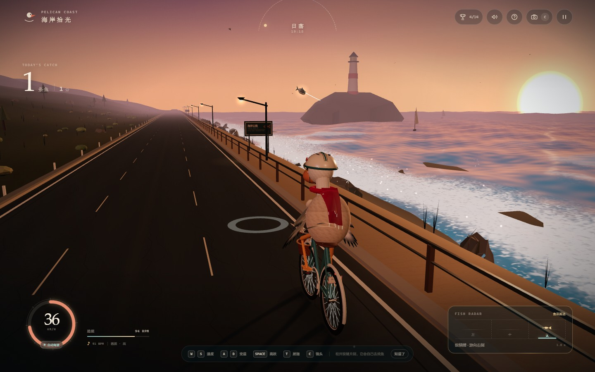
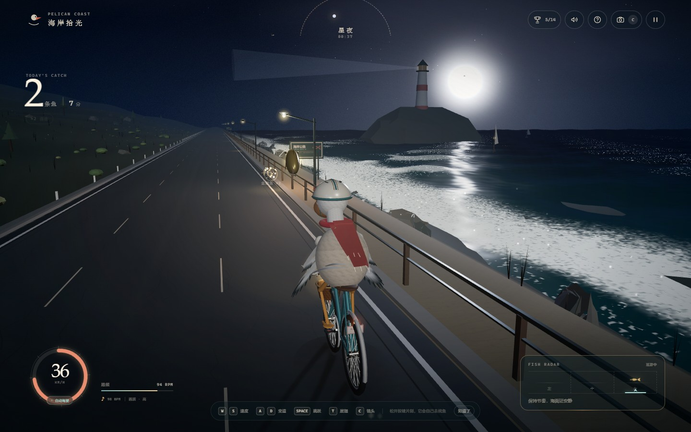

# 海岸拾光 · Pelican Coast

一只戴头盔、墨镜、系着红围巾的鹈鹕，骑一辆复古海岸自行车，在黄昏到星夜的公路上追鱼。

**在线游玩（CDN / GitHub Pages）**：https://freefoxcm.github.io/pelican-coast/




## 玩法

| 操作 | 按键 |
| --- | --- |
| 加速 / 减速 | `W` / `S` |
| 变道追鱼 | `A` / `D` |
| 跳跃 | `Space` |
| 展翅抬前轮 | `T` |
| 切换镜头 | `C` |
| 暂停 | `P` / `Esc` |
| 静音 | `M` |
| 收起全部界面 | `F` |

海面会先亮起银光，鱼会跃向其中一条车道。看准右侧鱼讯雷达和路面上的目标环，把车变到相同车道，鱼跃过身边时就会自动叼住。

- 金鳍鱼和月相鱼分数更高；连续捕鱼会累积连击。
- 车轮离地时接到鱼，会解锁「腾空捕手」。
- 松开所有骑行按键约 4 秒，自动驾驶会接管，自己找鱼、变道和加速；按任意骑行键随时拿回车把。
- 每一轮从黄昏开始，约 3 分钟后进入星空月夜与黎明，再回到黄昏。

## 5 种镜头

1. **追尾** — 海岸公路的主视角
2. **电影运镜** — 前侧环绕、低机位、海上摇臂、正面肖像和广角跟随之间自动剪辑
3. **鹈鹕视角** — 从眼睛看出去，能看见自己的长喙和鼻息孔
4. **海鸟航拍** — 从高处俯瞰整条海岸
5. **海岸侧拍** — 浪花、车轮和红围巾排成一列

## 14 枚成就

初见海岸、海风捕手、鱼贯而入、满载而归、三线并进、破风者、腾空捕手、展翅时刻、金色余晖、月下渔夫、以喙丈量、五镜巡游、长路漫漫、独自成团。

成就与统计保存在浏览器 `localStorage` 中。

## 技术说明

- **Three.js r180**，无外部图片、模型、字体或音频依赖；所有几何与材质在运行时程序化生成。
- **海岸公路**：程序化地形、滚动护栏、路灯、路牌、灯塔、岛屿、船只、海鸟、灌木与野花。
- **鹈鹕细节**：两只翼手在骑行时握住车把，T 展翅时翼手收拢、青绿飞羽展开；无缝一体羽身、颈部羽领、珊瑚盔花与盔羽、钩状喙尖与清漆高光。
- **海面**：自定义 GLSL 波浪场（多层涌浪、法线、菲涅尔、日/月反射、白浪与岸边碎浪），并叠加岸边水雾粒子。
- **天空**：连续调色的渐变天穹、太阳、月亮、带闪烁和多层银河的星场、低空云、流星、流星灯光束。
- **围巾**：双尾 Verlet 布料模拟，包含结构约束、弯曲约束、重力、风场、角色偏航惯性与身体椭球碰撞；围巾飘动方向会跟随车速、转向和腾空状态。
- **声音**：Web Audio 实时合成的环境海浪、风、链条、鸟鸣氛围、生成式配乐和全部 SFX。配乐 BPM 会跟随踏板踏频。
- **质量自适应**：根据实时帧率在 4 档画质之间切换阴影分辨率、像素比、草丛/灌木数量、海面细节与粒子密度。游戏使用单遍直接渲染，优先保证各显卡上的画面完整与兼容。
- **触屏**：自动检测粗指针设备，提供加速、刹车、左右变道、跳跃、展翅、镜头和暂停按钮。
- **无外部请求**：CDN 页面只加载同源文件。

### 本地运行

```powershell
python -m http.server 4173
# 打开 http://127.0.0.1:4173/
```

需要支持 WebGL 2 的现代浏览器。配乐需要首次点击后才能启动，这是浏览器的自动播放限制。

### 第三方

Three.js r180，MIT License，见 [vendor/three/LICENSE](vendor/three/LICENSE)。

---

全程都在浏览器里生成：海风没有文件，月光也没有。
